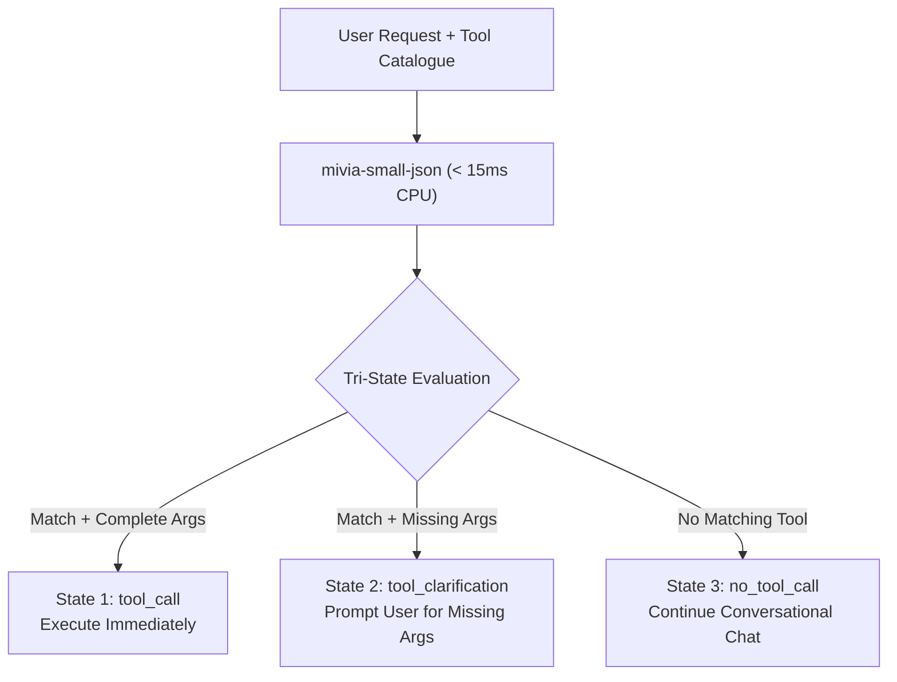

# 3-State Tool Routing & Clarification Architecture

Modern autonomous AI agents (CodeAct, SWE-agent, OpenHands, function-calling assistants) face a critical reliability barrier at the tool execution boundary:

1. **Premature Execution / Hallucination**: Agents attempt to call tools with fabricated or missing arguments when the user's intent is underspecified.
2. **False Positives / Over-calling**: Agents invoke arbitrary tools for general conversational inquiries or near-miss prompts when no relevant tool is registered.
3. **High Latency & Token Burn**: Round-tripping conversational ambiguity to large frontier models costs hundreds of milliseconds and significant token budget.

`mivia-small-json` provides an ultrafast, CPU-native pre-execution guard (p95 ~12-21 ms latency, a 23 MB gate + 23 MB rank int8 ONNX pair, < 2 GB RAM). Before executing any tool, the agent runtime routes the user prompt and tool catalogue through `mivia-small-json` into one of **three deterministic states**:



---

## 1. The Three States Explained

### State 1: `tool_call` (Immediate Execution)
- **Condition**: The user request aligns with a registered tool and all mandatory parameters can be resolved or repaired.
- **Payload**: Complete, strictly valid JSON record with healed arguments (`name`, `arguments`, `result`).
- **Agent Action**: Invoke the corresponding tool function immediately with the validated arguments.

### State 2: `tool_clarification` (Defensive Interception)
- **Condition**: High topical alignment with a registered tool, but one or more mandatory arguments are missing from the user request (e.g., asking *"calculate the sum"* without providing numbers, or asking *"fetch data from the endpoint"* without specifying a URL).
- **Payload**: Structured metadata detailing the intended tool, `missing_parameters`, `reason`, and a user-ready `clarification_prompt`.
- **Agent Action**: **Do not execute.** Return the `clarification_prompt` directly to the user to obtain the missing arguments, preventing hallucinated defaults, runtime exceptions, or unintended side effects.

### State 3: `no_tool_call` (Safe Abstention)
- **Condition**: The user prompt is conversational, explanatory, or out-of-domain relative to all listed tools in the catalogue (e.g., asking *"explain quicksort in Python"* when only weather and calculator tools are available).
- **Payload**: Explicit abstention record (`type: "no_tool_call"`, `reason: "no matching tool"`).
- **Agent Action**: Bypass tool execution entirely and forward the user's prompt to standard conversational LLM generation.

---

## 2. Input Protocol & Calling Pattern

The input string adheres to the standard Berkeley Function Calling Leaderboard (BFCL) format: a JSON tool array followed by the user request.

### Input Schema

```text
Tools available: [{"type": "function", "function": {"name": "<tool_name>", "description": "<description>", "parameters": {"type": "object", "properties": {...}, "required": [...]}}}]

User request: <user_prompt>
```

### Python Calling Pattern

```python
from mivia_small_json import pipeline, tool_call

# 1. Register schemas into the runtime registry (idempotent)
tool_call.register_tool_call_schema()
tool_call.register_no_tool_call_schema()
tool_call.register_tool_clarification_schema()

# 2. Load the verified router once per process (CPU-only, 118 MB int8 ONNX + tokenizer)
router = pipeline.load_active_router()

# 3. Classify the prompt and catalogue (< 15 ms, never raises)
result, meta = pipeline.classify(formatted_input, router=router)
```

---

## 3. Payloads for Each State

### State 1 Payload: `tool_call`

When all arguments are present, `mivia-small-json` normalizes single quotes, Python booleans (`True`/`False`), and trailing commas into strictly valid JSON arguments:

```json
{
  "type": "tool_call",
  "name": "calculate_sum",
  "arguments": "{\"numbers\":[10,25,35]}",
  "result": ""
}
```

Metadata:
```json
{
  "routed_by": "model",
  "valid": true,
  "retries": 0,
  "latency_ms": 7.42
}
```

### State 2 Payload: `tool_clarification`

When the intent matches a tool but mandatory parameters are omitted:

```json
{
  "type": "tool_clarification",
  "tool": "calculate_sum",
  "missing_parameters": ["numbers"],
  "reason": "Missing required argument 'numbers' for tool 'calculate_sum'",
  "clarification_prompt": "Please specify the list of numbers you would like to sum."
}
```

Metadata:
```json
{
  "routed_by": "model",
  "valid": true,
  "retries": 0,
  "latency_ms": 6.81
}
```

### State 3 Payload: `no_tool_call`

When no tool matches the request:

```json
{
  "type": "no_tool_call",
  "reason": "no matching tool"
}
```

Metadata:
```json
{
  "routed_by": "model",
  "valid": true,
  "retries": 0,
  "latency_ms": 8.15
}
```

---

## 4. Complete Agent Loop Integration

Below is an end-to-end implementation of an agent execution loop utilizing `mivia-small-json` to guard tool dispatch:

```python
import json
from typing import Any, Dict, List
from mivia_small_json import pipeline, tool_call

class SafeAgentRuntime:
    def __init__(self, tools: List[Dict[str, Any]]):
        self.tools = tools
        # Register tool schemas into the runtime registry (idempotent)
        tool_call.register_tool_call_schema()
        tool_call.register_no_tool_call_schema()
        tool_call.register_tool_clarification_schema()
        self.router = pipeline.load_active_router()
        self.tool_handlers = {
            "calculate_sum": self._handle_calculate_sum,
            "fetch_url": self._handle_fetch_url,
        }


    def _format_input(self, user_prompt: str) -> str:
        return f"Tools available: {json.dumps(self.tools)}\n\nUser request: {user_prompt}"

    def step(self, user_prompt: str) -> str:
        """Process a user turn with tri-state routing and safety checks."""
        raw_input = self._format_input(user_prompt)
        
        # Route through mivia-small-json (< 15 ms on CPU)
        result, meta = pipeline.classify(raw_input, router=self.router)
        signal_type = result.get("type")

        # --- State 1: Immediate tool execution ---
        if signal_type == "tool_call":
            tool_name = result["name"]
            arguments = json.loads(result["arguments"])
            handler = self.tool_handlers.get(tool_name)
            if handler:
                return handler(arguments)
            return f"Error: No handler registered for tool '{tool_name}'."

        # --- State 2: Proactive user clarification ---
        elif signal_type == "tool_clarification":
            missing = ", ".join(result.get("missing_parameters", []))
            prompt = result.get("clarification_prompt")
            # Present structured clarification to the user without calling any tool
            return f"{prompt} (Required parameter missing: {missing})"

        # --- State 3: Conversational fallback ---
        elif signal_type == "no_tool_call":
            return self._call_conversational_llm(user_prompt)

        # Fallback for general signal types or unstructured text
        return self._call_conversational_llm(user_prompt)

    def _handle_calculate_sum(self, args: Dict[str, Any]) -> str:
        numbers = args.get("numbers", [])
        return f"Result: {sum(numbers)}"

    def _handle_fetch_url(self, args: Dict[str, Any]) -> str:
        url = args.get("url", "")
        return f"Fetched 200 OK from {url}"

    def _call_conversational_llm(self, prompt: str) -> str:
        return f"Chat response: I'm happy to help you with '{prompt}'."
```

---

## 5. End-to-End Walkthrough Examples

### Scenario A: Clean Tool Call (`tool_call`)

**User Input:**
```text
Tools available: [{"name": "fetch_url", "description": "Fetch content from a web URL", "parameters": {"type": "object", "properties": {"url": {"type": "string"}}, "required": ["url"]}}]

User request: Download and inspect https://example.com/api/data
```

**Result:**
```json
{
  "type": "tool_call",
  "name": "fetch_url",
  "arguments": "{\"url\":\"https://example.com/api/data\"}",
  "result": ""
}
```
*Action:* Agent runs `fetch_url({"url": "https://example.com/api/data"})`.

---

### Scenario B: Missing Mandatory Arguments (`tool_clarification`)

**User Input:**
```text
Tools available: [{"name": "calculate_sum", "description": "Sum a list of numbers", "parameters": {"type": "object", "properties": {"numbers": {"type": "array", "items": {"type": "number"}}}, "required": ["numbers"]}}]

User request: Can you run calculate_sum for me?
```

**Result:**
```json
{
  "type": "tool_clarification",
  "tool": "calculate_sum",
  "missing_parameters": ["numbers"],
  "reason": "Missing required argument 'numbers' for tool 'calculate_sum'",
  "clarification_prompt": "Please provide the list of numbers you would like to sum."
}
```
*Action:* Agent pauses execution and asks: *"Please provide the list of numbers you would like to sum."*

---

### Scenario C: Unrelated Inquiries (`no_tool_call`)

**User Input:**
```text
Tools available: [{"name": "fetch_url", "description": "Fetch content from a URL", "parameters": {"type": "object", "properties": {"url": {"type": "string"}}, "required": ["url"]}}]

User request: Write a haiku about autumn leaves.
```

**Result:**
```json
{
  "type": "no_tool_call",
  "reason": "no matching tool"
}
```
*Action:* Agent skips tool execution and responds with a haiku.

---

## 6. Technical Guarantees

| Invariant | Guarantee |
|---|---|
| **Latency** | $< 15\text{ ms}$ on single-core CPU (p95) |
| **Memory Footprint** | $< 2\text{ GB}$ RSS total process footprint |
| **Model Size** | $\approx 23\text{ MB}$ int8 quantized ONNX cross-encoder |
| **Exception Safety** | `pipeline.classify` never raises; invalid or corrupt inputs degrade to honest fallbacks |
| **JSON Strictness** | Zero malformed JSON escapes; unquoted keys, single quotes, and trailing commas are repaired |
