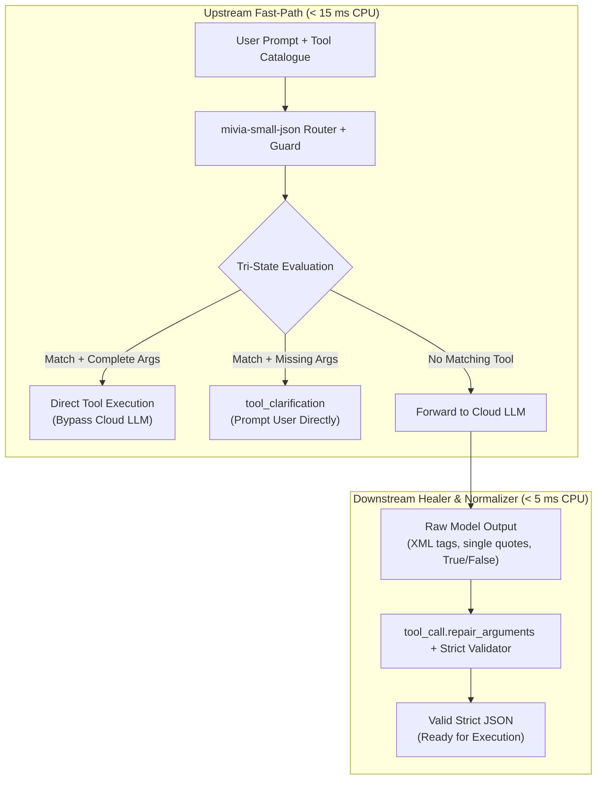
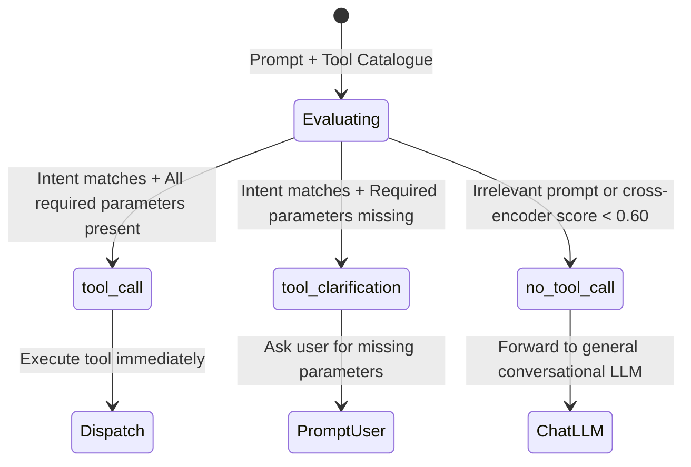
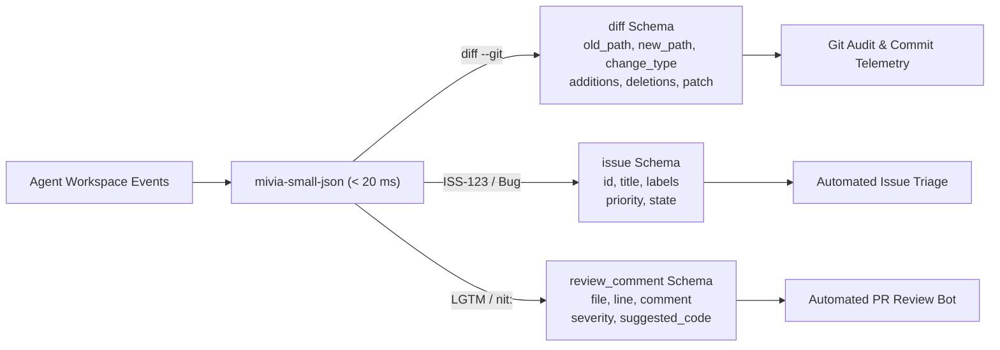
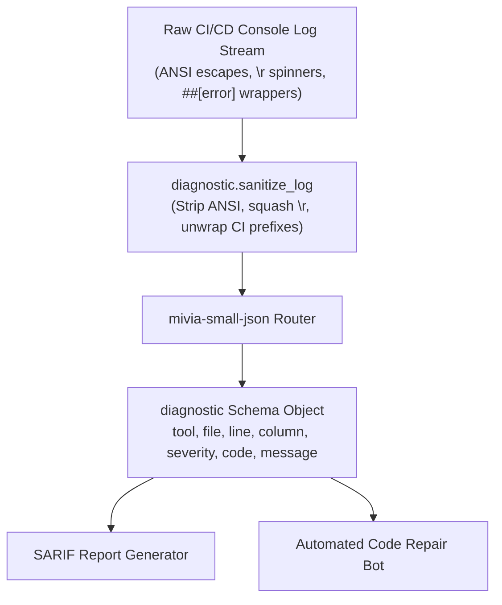
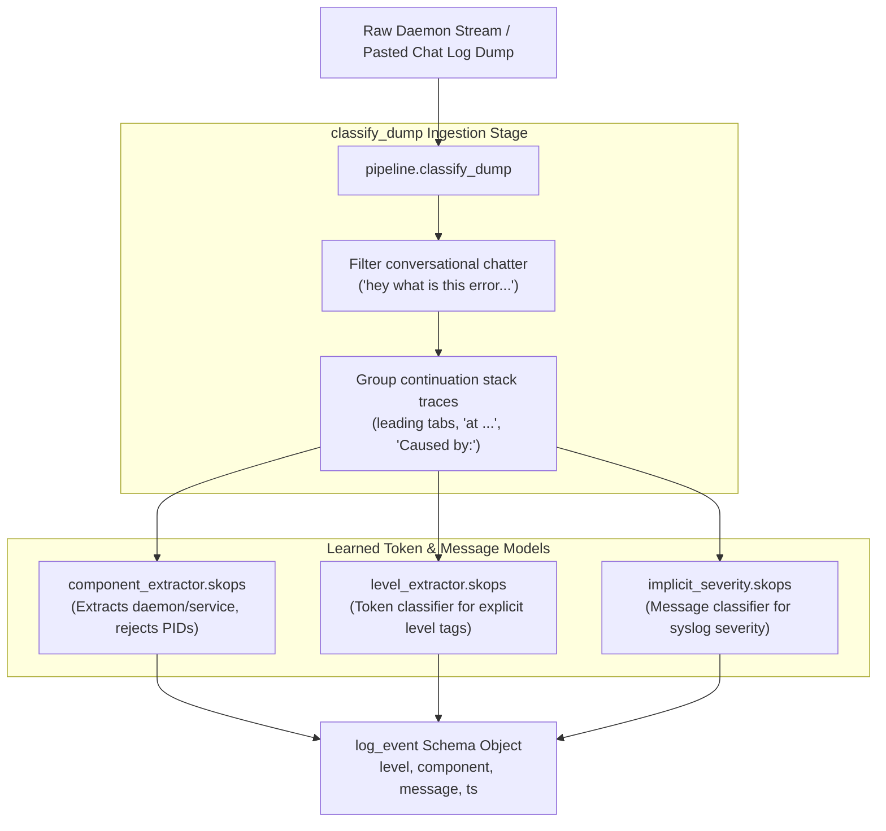
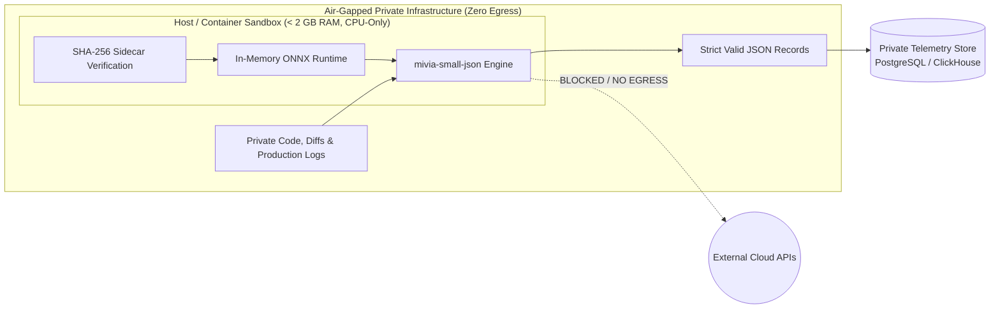
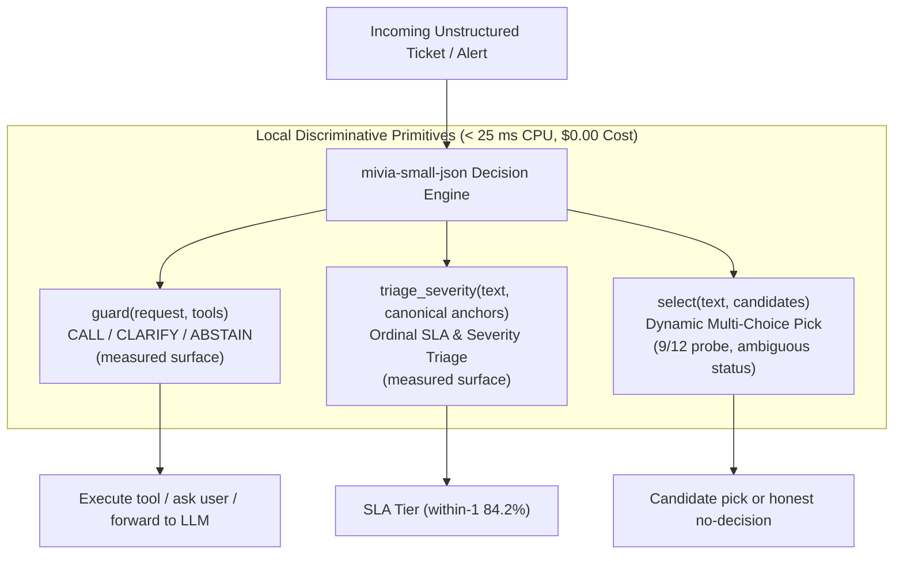
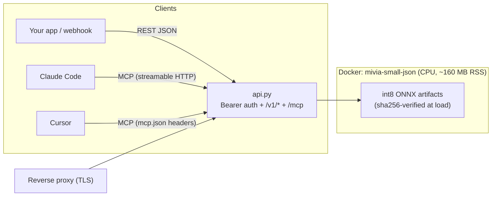

# Production Architecture & Use Cases: mivia-small-json

`mivia-small-json` is a specialized, CPU-native ML model and deterministic runtime (≈ 165 MB of int8 ONNX weights (router 118 MB + the guard's gate/rank pair + the heads), each sha256-verified; < 2 GB RAM; 0 GPU required) engineered to structure chaotic, unstructured software development signals into strictly-validated JSON records.

This document serves as the enterprise production guide, detailing the **8 core production architectures**, cross-system integration patterns, benchmarks, and executable implementations.

---

## Table of Contents

1. [Executive Overview & Schema Capability Matrix](#1-executive-overview--schema-capability-matrix)
2. [Architecture 1: The LLM Function-Calling Adapter & Sanitizer (Upstream & Downstream)](#2-architecture-1-the-llm-function-calling-adapter--sanitizer-upstream--downstream)
   - [1.1 Upstream Guard (Fast Pre-LLM Bypass)](#11-upstream-guard-fast-pre-llm-bypass)
   - [1.2 Downstream Output Healer & Bridge](#12-downstream-output-healer--bridge)
   - [1.3 Tri-State Execution Guard (`tool_call`, `tool_clarification`, `no_tool_call`)](#13-tri-state-execution-guard-tool_call-tool_clarification-no_tool_call)
3. [Architecture 2: Autonomous Coding Agent Workspace Telemetry](#3-architecture-2-autonomous-coding-agent-workspace-telemetry)
   - [2.1 Git Diff & Patch Structuring (`diff`)](#21-git-diff--patch-structuring-diff)
   - [2.2 Developer Issue Reports & Bug Tracking (`issue`)](#22-developer-issue-reports--bug-tracking-issue)
   - [2.3 Code Review Suggestions (`review_comment`)](#23-code-review-suggestions-review_comment)
4. [Architecture 3: Compiler, Linter & CI/CD Diagnostics Pipeline](#4-architecture-3-compiler-linter--cicd-diagnostics-pipeline)
   - [3.1 ANSI & CI Wrapper Sanitization (`diagnostic.sanitize_log`)](#31-ansi--ci-wrapper-sanitization-diagnosticsanitize_log)
   - [3.2 Polyglot Compiler & Linter Structuring (`diagnostic`)](#32-polyglot-compiler--linter-structuring-diagnostic)
   - [3.3 End-to-End Automated CI/CD Failure Triage](#33-end-to-end-automated-cicd-failure-triage)
5. [Architecture 4: High-Throughput Multi-Line Daemon & Infrastructure Log Ingestion](#5-architecture-4-high-throughput-multi-line-daemon--infrastructure-log-ingestion)
   - [4.1 Learned Token-Level Extraction (`component_extractor`, `level_extractor`)](#41-learned-token-level-extraction-component_extractor-level_extractor)
   - [4.2 Message-Level Implicit Severity for Syslog (`implicit_severity`)](#42-message-level-implicit-severity-for-syslog-implicit_severity)
   - [4.3 Mixed Stream & Conversational Dump Parsing (`classify_dump`)](#43-mixed-stream--conversational-dump-parsing-classify_dump)
6. [Architecture 5: Air-Gapped & Edge Local Deployment](#6-architecture-5-air-gapped--edge-local-deployment)
   - [5.1 CPU-Only Resource Profile (118 MB int8 ONNX, < 2 GB RAM, 0 GPU)](#51-cpu-only-resource-profile--23-mb-onnx--2-gb-ram-0-gpu)
   - [5.2 Zero Network Egress & Air-Gapped Security](#52-zero-network-egress--air-gapped-security)
   - [5.3 Cryptographic Integrity via SHA-256 Sidecars](#53-cryptographic-integrity-via-sha-256-sidecars)
7. [Architecture 6: Zero-Shot Discriminative Decision Primitives & Free Ticket Triage](#7-architecture-6-zero-shot-discriminative-decision-primitives--free-ticket-triage)
   - [6.1 Elimination of Expensive Cloud LLM Calls for Classification](#61-elimination-of-expensive-cloud-llm-calls-for-classification)
   - [6.2 Dynamic Option Selection (`select`) for Ticket & Webhook Categorization](#62-dynamic-option-selection-select-for-ticket--webhook-categorization)
   - [6.3 Ordinal Severity & SLA Grading (`grade`) for Incident Triage](#63-ordinal-severity--sla-grading-grade-for-incident-triage)
   - [6.4 Calibrated Binary Entailment Verification (`verify`)](#64-calibrated-binary-entailment-verification-verify)
   - [6.5 Complete Automated Ticket Triage Pipeline](#65-complete-automated-ticket-triage-pipeline)
8. [Architecture 7: Zero-Retraining Dynamic Schema Engine](#8-architecture-7-zero-retraining-dynamic-schema-engine)
   - [7.1 Registering Custom Enterprise Schemas in Python](#71-registering-custom-enterprise-schemas-in-python)
   - [7.2 Dynamic Schema Routing & Validation](#72-dynamic-schema-routing--validation)
9. [Architecture 8: Cascaded Speculative Verification Architecture](#9-architecture-8-cascaded-speculative-verification-architecture)
   - [8.1 Fast Gate to Deep Escalation Verifier](#81-fast-gate-to-deep-escalation-verifier)
   - [8.2 Latency Economics & 8,192-Token Long Context Handling](#82-latency-economics--8192-token-long-context-handling)
10. [Deployment: Serving the Model over the Internet (API + MCP + Docker)](#10-deployment-serving-the-model-over-the-internet-api--mcp--docker)
11. [Production Verification & Benchmark Telemetry](#11-production-verification--benchmark-telemetry)
11b. [Verified Production Use Cases](#11b-verified-production-use-cases)
12. [Quick-Start Production Boilerplate](#12-quick-start-production-boilerplate)

---

## 1. Executive Overview & Schema Capability Matrix

Modern developer platforms, AI agent loops, and observability clusters ingest heterogeneous text streams: raw diffs, terminal traces with ANSI color escapes, stack traces, conversational chat snippets, and malformed model outputs. Round-tripping all raw text through frontier cloud LLMs introduces prohibitive latency (500–2,000 ms), high token expense, and unpredictable JSON syntax errors.

`mivia-small-json` sits directly in the processing pipeline as an ultra-fast local filter and transformer. It classifies signals across **11 first-class outcomes** — the 10 workflow schemas plus the trained plain-`text` class (chat, invoices, news, recipes in any language are first-class records, never forced into a workflow schema), with `tool_clarification` as the guard's structured ask-back state, extracts strongly-typed attributes via learned token classifiers, and validates against strict schemas with a bounded retry repair budget ($\le 2$ repair attempts):

| Schema Name | Target Signals | Core Structured Fields | Key Extractors / Classifiers | Production Role |
|---|---|---|---|---|
| `tool_call` | AI agent tool invocations, function calls | `name`, `arguments`, `result` | `tool_call.repair_arguments`, int8 cross-encoder guard | Action dispatch & LLM syntax normalization |
| `no_tool_call` | Guard-level abstention on non-tool requests | `reason` | `tool_match.ToolMatcher` (int8 cross-encoder at the canonical operating point) | The guard's abstention record: a request the catalogue cannot serve, emitted instead of a guessed call |
| `text` | Chat, invoices, news, recipes — any non-workflow text, any language | `reason` | The router's trained non-workflow class (0 spurious predictions on 350 in-domain rows) | First-class general text: support inboxes and community chat come back as honest text records, never forced into a schema |
| `tool_clarification`* | Tool matches with missing mandatory parameters | `tool`, `reason`, `missing_parameters`, `clarification_prompt` | `tool_match.validate_fillability` deterministic gate (< 0.05 ms) | Pre-execution user clarification, preventing runtime crash |
| `diff` | Unified git diffs, commits, patches | `old_path`, `new_path`, `change_type`, `additions`, `deletions`, `patch` | `diff_comment.extract_diff`, regex hunk parser | Workspace patch telemetry, SWE-bench evaluation |
| `issue` | Bug tickets, issue tracker descriptions | `id`, `title`, `labels`, `priority`, `state` | Model router, keyword rules fallback | Automated issue triage & defect classification |
| `diagnostic` | Compiler errors, linter output, test failures | `tool`, `file`, `line`, `column`, `severity`, `code`, `message` | `diagnostic.sanitize_log`, regex pattern ladder | Build failure analysis (rustc, tsc, gcc, ruff, pytest) |
| `review_comment` | Inline PR comments, code suggestions | `file`, `line`, `comment`, `severity`, `suggested_code` | `diff_comment.extract_review_comment`, markdown suggestion extractor | Code review automation & inline PR bots |
| `log_event` | Server, container, kernel, daemon logs | `level`, `component`, `message`, `ts` | `component_extractor.skops`, `level_extractor.skops`, `implicit_severity.skops` | High-throughput log aggregation (LogHub 16 systems) |
| `commit` | Git commit logs, conventional commits | `sha`, `message`, `files_changed`, `author`, `commit_type` | Commit regex ladder, SHA validator | Git audit pipelines & change log generation |
| `pull_request` | PR titles, metadata, changelogs | `number`, `title`, `author`, `state`, `additions`, `deletions` | Example extensible schema bootstrap | VCS platform webhooks & telemetry |

*\*Note: `tool_clarification` is a specialized operational state emitted when `tool_clarification` is active in the registry.*

---

## 2. Architecture 1: The LLM Function-Calling Adapter & Sanitizer (Upstream & Downstream)

### Architecture Overview

In autonomous agent systems (SWE-agent, OpenHands, AutoGPT, CodeAct), tool interactions suffer from two major friction points:
1. **Upstream Waste**: Simple or deterministic tool calls hit slow cloud LLMs, burning tokens and adding 500+ ms of round-trip network latency.
2. **Downstream Malformations**: Small or open-weight models (Llama 3 8B, Mistral 7B, Gemma 2, fine-tuned SLMs) frequently emit invalid JSON (single quotes, trailing commas, Python `True`/`False`/`None`, or raw XML tags like `<tool_call>` or `<functioncall>`), causing runtime crashes.

`mivia-small-json` provides a dual-sided architecture: an **Upstream Pre-LLM Bypass Guard** and a **Downstream Output Healer & Schema Bridge**.



---

### 1.1 Upstream Guard (Fast Pre-LLM Bypass)

When a user request matches a deterministic tool in the registered catalogue and includes the necessary arguments, the agent runtime invokes the tool immediately (< 15 ms on CPU) without incurring cloud LLM token costs or latency. For tools whose required parameters are all strings, the arguments are filled deterministically from the request text itself — key-delimited (`service=nginx`, `"host": "web-01"`) and alignment (`host is web-01`) ladders return the exact verbatim spans with no model in the loop; a value the request text cannot prove is never invented (the honest empty-arguments minimum / clarification path holds instead).

```python
import json
from mivia_small_json import pipeline, tool_call

# 1. Register tool schemas in the process
tool_call.register_tool_call_schema()
tool_call.register_no_tool_call_schema()
tool_call.register_tool_clarification_schema()

# 2. Load the verified ONNX int8 router
router = pipeline.load_active_router()

# 3. Define the tool catalogue
tools = [
    {
        "type": "function",
        "function": {
            "name": "lookup_weather",
            "description": "Fetch current weather forecast for a specified city.",
            "parameters": {
                "type": "object",
                "properties": {
                    "city": {"type": "string", "description": "City name"}
                },
                "required": ["city"]
            }
        }
    }
]

# 4. Format prompt in Berkeley Function Calling Leaderboard (BFCL) format
prompt = f"Tools available: {json.dumps(tools)}\n\nUser request: lookup_weather for city Boston"

# 5. Classify (< 15 ms CPU)
record, meta = pipeline.classify(prompt, router=router)

if record["type"] == "tool_call":
    print(f"Fast-path tool executed: {record['name']}")
    # Direct dispatch without calling remote LLM
```

---

### 1.2 Downstream Output Healer & Bridge

Open-source and smaller enterprise models often return syntax that breaks standard `json.loads`:
- Single-quoted keys/values: `{'path': 'src/main.py'}`
- Python literals: `True`, `False`, `None` instead of `true`, `false`, `null`
- Trailing commas: `{"limit": 10, "offset": 0,}`
- Escaped wrapper strings: `"{\"target\": \"prod\"}"`
- Embedded XML fences: `<tool_call>...</tool_call>` or `<functioncall>...</functioncall>`

`tool_call.repair_arguments()` repairs these syntax errors into standard, compact JSON without throwing exceptions:

```python
import json
from mivia_small_json.tool_call import repair_arguments

# Typical raw output from an 8B model or local SLM
malformed_llm_args = """
{
    'filepath': 'config/settings.yaml',
    'overwrite': True,
    'backup': False,
    'comment': None,
    'tags': ['infra', 'k8s',],
}
"""

# Repair to strict RFC 8259 JSON in < 0.1 ms
clean_json_str = repair_arguments(malformed_llm_args)
print("Repaired JSON string:", clean_json_str)

# Guaranteed to parse cleanly with Python's standard library
parsed_args = json.loads(clean_json_str)
assert parsed_args["overwrite"] is True
assert parsed_args["backup"] is False
assert parsed_args["comment"] is None
assert parsed_args["tags"] == ["infra", "k8s"]
```

---

### 1.3 Tri-State Execution Guard (`tool_call`, `tool_clarification`, `no_tool_call`)

Autonomous agents frequently hallucinate missing arguments when a user prompt is underspecified. Rather than executing with fake parameters or crashing, `mivia-small-json` provides a **Tri-State Guard**:



#### Production Tri-State Implementation

> **String-parameter filling:** when a matched tool's required parameters are all strings, the values are filled from the request text verbatim by deterministic key-delimited and alignment ladders — the exact spans, no model bytes involved. A slot the text cannot prove goes to the honest minimum (`{}`) / clarification path; values are never fabricated.

```python
import json
from mivia_small_json import pipeline, tool_call

tool_call.register_tool_call_schema()
tool_call.register_no_tool_call_schema()
tool_call.register_tool_clarification_schema()
router = pipeline.load_active_router()

tools = [
    {
        "type": "function",
        "function": {
            "name": "calculate_sum",
            "description": "Calculate the mathematical sum of two numbers.",
            "parameters": {
                "type": "object",
                "properties": {
                    "num1": {"type": "number", "description": "First number"},
                    "num2": {"type": "number", "description": "Second number"}
                },
                "required": ["num1", "num2"]
            }
        }
    }
]
tools_json = json.dumps(tools)

# Case 1: Confirmed tool execution (all parameters provided)
req1 = f"Tools available: {tools_json}\n\nUser request: calculate the sum of 15 and 30"
res1, meta1 = pipeline.classify(req1, router=router)
assert res1["type"] == "tool_call"
print("State 1 -> tool_call:", res1["name"])

# Case 2: Intent matches, but parameters are missing
req2 = f"Tools available: {tools_json}\n\nUser request: calculate the sum"
res2, meta2 = pipeline.classify(req2, router=router)
assert res2["type"] == "tool_clarification"
print("State 2 -> tool_clarification:")
print("  Tool:", res2["tool"])
print("  Missing parameters:", res2["missing_parameters"])
print("  Suggested user prompt:", res2["clarification_prompt"])

# Case 3: Not a tool match (conversational or irrelevant)
req3 = f"Tools available: {tools_json}\n\nUser request: explain quantum entanglement in physics"
res3, meta3 = pipeline.classify(req3, router=router)
assert res3["type"] == "no_tool_call"
print("State 3 -> no_tool_call:", res3["reason"])
```

---

## 3. Architecture 2: Autonomous Coding Agent Workspace Telemetry

### Architecture Overview

Coding agent harnesses (e.g., SWE-bench agents, PR bots, codebase assistants) constantly process workspace modifications, bug descriptions, and reviewer feedback. `mivia-small-json` provides native, deterministic parsers for:
- `diff`: Git patches and hunk diffs.
- `issue`: Bug descriptions, issue tracker bodies, and tracebacks.
- `review_comment`: Code review feedback, severity ratings, and markdown ````suggestion` blocks.



---

### 2.1 Git Diff & Patch Structuring (`diff`)

`mivia-small-json` extracts file paths, hunk modifications, additions, and deletions from raw unified diffs in **~18 ms p50 CPU latency**. In external validation on **SWE-bench Lite** (100 multi-file repository tasks across Django and Astropy), it achieved **100.0% path extraction accuracy** and **100.0% valid JSON**.

```python
from mivia_small_json import diff_comment, pipeline

# Register diff and review schemas
diff_comment.register_diff_and_review_schemas()
router = pipeline.load_active_router()

raw_unified_diff = """diff --git a/src/auth/jwt.py b/src/auth/jwt.py
index e69de29..b7e12b6 100644
--- a/src/auth/jwt.py
+++ b/src/auth/jwt.py
@@ -14,4 +14,5 @@ def verify_token(token: str) -> bool:
     if not token:
-        return False
+        raise ValueError("Token cannot be empty")
+    return decode_jwt(token) is not None
"""

record, meta = pipeline.classify(raw_unified_diff, router=router)

print("Parsed Diff:")
print(f"  Type:        {record['type']}")
print(f"  Old path:    {record['old_path']}")
print(f"  New path:    {record['new_path']}")
print(f"  Change type: {record['change_type']}")
print(f"  Additions:   {record['additions']}")
print(f"  Deletions:   {record['deletions']}")
print(f"  Latency:     {meta['latency_ms']} ms")

assert record["old_path"] == "src/auth/jwt.py"
assert record["new_path"] == "src/auth/jwt.py"
assert record["change_type"] == "modify"
assert record["additions"] == 2
assert record["deletions"] == 1
```

---

### 2.2 Developer Issue Reports & Bug Tracking (`issue`)

Developer bug descriptions, stack traces, and ticket reports are automatically mapped to structured `issue` records. The model accurately separates issue IDs, titles, labels, priorities, and status even when nested inside error logs:

```python
from mivia_small_json import pipeline

router = pipeline.load_active_router()

raw_ticket = """ISS-4091: Connection pool exhaustion during high-concurrency batch sync
Priority: high
Labels: backend, postgres, performance
State: open

Traceback (most recent call last):
  File "db/pool.py", line 82, in acquire
    raise PoolTimeoutError("Queue pool limit of size 10 overflow 20 reached")
PoolTimeoutError: Queue pool limit of size 10 overflow 20 reached
"""

record, meta = pipeline.classify(raw_ticket, router=router)

print("Parsed Issue:")
print(f"  ID:       {record['id']}")
print(f"  Priority: {record['priority']}")
print(f"  Labels:   {record['labels']}")
print(f"  State:    {record['state']}")

assert record["type"] == "issue"
assert record["id"] == "ISS-4091"
assert record["priority"] == "high"
assert "postgres" in record["labels"]
```

---

### 2.3 Code Review Suggestions (`review_comment`)

Inline pull request comments emitted by reviewers or AI agents are parsed into structured feedback containing target file, line number, severity classification (`nit`, `suggestion`, `warning`, `blocking`), and cleanly extracted replacement code blocks:

```python
from mivia_small_json import diff_comment, pipeline

diff_comment.register_diff_and_review_schemas()
router = pipeline.load_active_router()

pr_review_input = """nit: file: `src/utils/crypto.py` line: 42
Consider using `secrets.compare_digest` to prevent timing attacks.
```suggestion
import secrets
return secrets.compare_digest(hash_a, hash_b)
```"""

record, meta = pipeline.classify(pr_review_input, router=router)

print("Parsed Review Comment:")
print(f"  File:           {record['file']}")
print(f"  Line:           {record['line']}")
print(f"  Severity:       {record['severity']}")
print(f"  Suggested code:\n{record['suggested_code']}")

assert record["type"] == "review_comment"
assert record["file"] == "src/utils/crypto.py"
assert record["line"] == 42
assert record["severity"] == "nit"
assert "secrets.compare_digest" in record["suggested_code"]
```

---

## 4. Architecture 3: Compiler, Linter & CI/CD Diagnostics Pipeline

### Architecture Overview

CI/CD runners (GitHub Actions, GitLab CI, Jenkins, CircleCI) produce raw, cluttered console outputs with terminal ANSI escape codes, progress spinners (`\r`), and provider-specific envelope wrappers (`##[error]`, `::error::`).

The `diagnostic` pipeline cleans the raw streams and structures multi-language compiler outputs into a unified schema conforming to SARIF and Language Server Protocol (LSP) norms.



---

### 4.1 ANSI & CI Wrapper Sanitization (`diagnostic.sanitize_log`)

`diagnostic.sanitize_log()` prepares raw console text for analysis:
- Strips terminal ANSI color and formatting escape sequences (`\x1b[...]`).
- Squashes carriage returns (`\r`), preserving only the final rendered line (removing progress-bar spam).
- Strips CI-specific envelope tags (e.g. GitHub Actions `##[error]`, `##[group]`, `::error::`).
- Removes prepended ISO timestamps.

```python
from mivia_small_json import diagnostic

raw_terminal_log = (
    "\x1b[31m2026-10-05T14:30:00.123Z ##[error]src/server.ts(24,10): "
    "error TS2345: Argument of type 'null' is not assignable to 'string'.\x1b[0m\r"
    "Progress: [100%]\r"
    "\x1b[31m##[error]src/server.ts(24,10): error TS2345: Argument of type 'null' is not assignable to 'string'.\x1b[0m"
)

sanitized = diagnostic.sanitize_log(raw_terminal_log)
print("Sanitized text:")
print(sanitized)
# Output: src/server.ts(24,10): error TS2345: Argument of type 'null' is not assignable to 'string'.
```

---

### 4.2 Polyglot Compiler & Linter Structuring (`diagnostic`)

The `diagnostic` schema captures compiler and linter diagnostics across Rust, TypeScript, Python, C/C++, and pytest:

```python
from mivia_small_json import diagnostic, pipeline

diagnostic.register_diagnostic_schema()
router = pipeline.load_active_router()

test_diagnostics = [
    # 1. Rust compiler error (rustc)
    """error[E0308]: mismatched types
  --> src/models.rs:18:24
   |
18 |     let x: u32 = "invalid";
   |                  ^^^^^^^^^ expected `u32`, found `&str`""",

    # 2. TypeScript compiler error (tsc)
    "src/client.ts:45:7: error TS2322: Type 'string' is not assignable to type 'number'.",

    # 3. Python linter error (ruff)
    "backend/server.py:12:1: F401 `os` imported but unused",

    # 4. GCC / Clang C++ error
    "src/engine.cpp:104:12: error: ‘shared_ptr’ in namespace ‘std’ does not name a template type"
]

for raw in test_diagnostics:
    record, meta = pipeline.classify(raw, router=router)
    print(f"Tool: {record['tool']:<10} File: {record['file']:<20} Line: {record['line']:<4} Severity: {record['severity']}")
    assert record["type"] == "diagnostic"
```

---

### 4.3 End-to-End Automated CI/CD Failure Triage

```python
import json
from mivia_small_json import diagnostic, pipeline

def triage_ci_output(raw_build_log: str) -> list[dict]:
    """Clean, parse, and structure CI/CD build failures into actionable objects."""
    diagnostic.register_diagnostic_schema()
    router = pipeline.load_active_router()
    
    clean_log = diagnostic.sanitize_log(raw_build_log)
    records = pipeline.classify_dump(clean_log, router=router)
    
    actionable_diagnostics = []
    for obj, meta in records:
        if obj.get("type") == "diagnostic":
            actionable_diagnostics.append(obj)
            
    return actionable_diagnostics

# Example CI output
ci_output = """
2026-10-05T12:00:00Z ##[group]Running build
\x1b[31m##[error]src/api.rs:42:15: error[E0425]: cannot find value `config` in this scope\x1b[0m
2026-10-05T12:00:02Z ##[endgroup]
"""

results = triage_ci_output(ci_output)
print(json.dumps(results, indent=2))
```

---

## 5. Architecture 4: High-Throughput Multi-Line Daemon & Infrastructure Log Ingestion

### Architecture Overview

High-throughput systems (Kubernetes daemonsets, OpenSSH bastions, Hadoop/Spark worker nodes, systemd syslog) generate gigabytes of log events per hour. In real environments, these streams contain two common challenges:
1. **Implicit Severity**: Standard syslog daemons (e.g. `sshd`, `kernel`, `postfix`) do not emit explicit severity keywords (like `ERROR` or `WARN`); their severity is implied by the log message (e.g., *"authentication failure"* $\to$ `ERROR`).
2. **Multi-Line Continuation**: Exceptions in Java, Python, or Go produce continuation lines (`at ...`, `Caused by:`) that must be grouped with their parent log line rather than split into orphan records.



---

### 4.1 Learned Token-Level Extraction (`component_extractor`, `level_extractor`)

Deterministic regexes are brittle across diverse logging libraries. `mivia-small-json` provides token-level scikit-learn models (`FeatureHasher` + `LogisticRegression` via `skops`) trained on diverse corpora:
- `component_extractor.skops`: Identifies service/daemon names (e.g., `sshd`, `org.apache.hadoop.hdfs.DFSClient`), while rejecting process IDs (PIDs) and timestamps. Achieves **100.0% accuracy on LogHub 16 systems** (29,996 / 30,000 lines).
- `level_extractor.skops`: Extracts explicit log severity tags across 9 standard systems with **100.0% accuracy** (18,000 / 18,000 lines).

```python
from mivia_small_json import pipeline

# Ingest an Apache Hadoop node log
raw_log = "2026-10-05 08:14:22,109 INFO org.apache.hadoop.hdfs.server.datanode.DataNode: BlockVerification completed for blk_1073741825"

record, meta = pipeline.classify(raw_log)

print("Parsed Log Event:")
print(f"  Level:     {record['level']}")
print(f"  Component: {record['component']}")
print(f"  Message:   {record['message']}")
print(f"  Timestamp: {record['ts']}")

assert record["type"] == "log_event"
assert record["level"] == "INFO"
assert record["component"] == "org.apache.hadoop.hdfs.server.datanode.DataNode"
```

---

### 4.2 Message-Level Implicit Severity for Syslog (`implicit_severity`)

Standard syslog and kernel logs omit explicit level tags (e.g., `INFO`, `ERROR`). `implicit_severity.skops` classifies semantic severity directly from the message text:

| Message Text | Explicit Tag | Inferred Severity (`implicit_severity`) |
|---|---|---|
| `authentication failure; logname= uid=0 euid=0` | *None* | `ERROR` |
| `Failed password for invalid user admin from 1.2.3.4` | *None* | `WARN` |
| `session closed for user root` | *None* | `INFO` |
| `Connection closed by 192.168.1.1 port 22 [preauth]` | *None* | `INFO` |

```python
from mivia_small_json import pipeline

syslog_line = "Jun 14 15:16:01 combo sshd[19939]: authentication failure; logname= uid=0 euid=0 tty=NODEVssh ruser= rhost=1.2.3.4"

record, meta = pipeline.classify(syslog_line)

print("Syslog Inferred Record:")
print(f"  Component: {record['component']}")
print(f"  Level:     {record['level']} (Inferred via implicit_severity)")
print(f"  Message:   {record['message']}")

assert record["component"] == "sshd"
assert record["level"] == "ERROR"
```

---

### 4.3 Mixed Stream & Conversational Dump Parsing (`classify_dump`)

Developers often paste mixed messages into issues or chat (e.g. Slack/Discord) containing conversational greetings alongside stack traces. `pipeline.classify_dump()` processes these dumps by:
1. Scoring every chunk with the router — conversational lines are kept as their own valid record, never silently dropped (in the example below the chat line comes back as a first-class `issue` record; filter by `type` downstream if you only want logs).
2. Grouping Java/Python stack traces (`at ...`, `Caused by:`, leading tabs/spaces) into single records with their parent log line.
3. Preserving atomic entities (`diff`, `diagnostic`, `issue`).

```python
from mivia_small_json import pipeline

dump = """hey team, can someone check what happened to the payment service?
2026-10-05T14:15:00Z ERROR [payment-service]: Unhandled exception in transaction handler
    at com.payment.Processor.charge(Processor.java:142)
    Caused by: java.net.SocketTimeoutException: Connect timed out to gateway
2026-10-05T14:15:04Z INFO [payment-service]: Retrying gateway connection attempt 2
"""

records = pipeline.classify_dump(dump)

print(f"Extracted {len(records)} records:")
for obj, meta in records:
    print(f"- type={obj['type']} level={obj.get('level')} "
          f"component={obj.get('component')} (valid: {meta['valid']})")

# The chat line comes back as its own valid record (an `issue` here):
# the dump contract keeps every router-scored chunk, so no user content
# is silently dropped.
assert len(records) == 3
assert records[0][0]["type"] == "issue"
assert records[1][0]["type"] == "log_event"
assert records[1][0]["level"] == "ERROR"
assert records[1][0]["component"] == "payment-service"
assert records[2][0]["level"] == "INFO"
```

Output on the shipped artifact:

```text
Extracted 3 records:
- type=issue level=None component=None (valid: True)
- type=log_event level=ERROR component=payment-service (valid: True)
- type=log_event level=INFO component=payment-service (valid: True)
```

---

## 6. Architecture 5: Air-Gapped & Edge Local Deployment

### Architecture Overview

Enterprises in defense, finance, healthcare, and air-gapped critical infrastructure enforce strict network egress controls: developer code, proprietary diffs, and server logs cannot be transmitted to external cloud APIs.

`mivia-small-json` provides an **air-gapped local architecture**:
- **Zero Network Transmission**: Operates entirely in-process or local localhost Unix socket without network dependencies.
- **CPU-Only Efficiency**: Runs on low-cost compute instances or developer laptops (< 2 GB RAM, 0 GPU required).
- **CPU-Sized Artifact**: Shipped as an int8 ONNX encoder (118 MB + 17 MB tokenizer) verified by cryptographic SHA-256 sidecars; the guard chain is a 23 MB gate + 23 MB rank pair.



---

### 5.1 CPU-Only Resource Profile (118 MB int8 ONNX, < 2 GB RAM, 0 GPU)

In high-density server configurations, memory budgets are strictly enforced:

| Resource Dimension | Budget Limit | `mivia-small-json` Actual | Status |
|---|---|---|---|
| **Model Weight Size** | — | **≈ 165 MB** int8 ONNX (router 118 MB + tokenizer 17 MB + guard gate/rank 23 MB + heads) | sha256-verified |
| **Peak Runtime Memory** | < 2,048 MB | **878 MB sustained** full chain under load (≈ 160 MB at boot) | Pass |
| **GPU Dependency** | 0 GPU (CPU-only) | **0 GPU** (`CPUExecutionProvider`) | Pass |
| **Inference Latency** | < 50 ms | **~2.7–19 ms per decision** (router p95 ≈ 10 ms; `benchmark-throughput.md`: 34 req/s mixed) | Pass |
| **External Network Calls** | 0 calls | **0 calls** (Air-gapped verified) | Pass |

---

### 5.2 Zero Network Egress & Air-Gapped Security

`mivia-small-json` uses only local files and standard system libraries (`onnxruntime`, `tokenizers`, `scikit-learn`, `skops`). No telemetry, usage statistics, or data snippets are transmitted over the network.

To verify in isolated environments:

```bash
# Verify no external sockets or network descriptors are opened during inference
python3 -c "
import socket
from mivia_small_json import pipeline

# Block external socket connections
socket.socket = None

record, meta = pipeline.classify('ERROR [auth]: token expired')
print('Air-gapped execution verified:', record['type'], meta['valid'])
"
```

---

### 5.3 Cryptographic Integrity via SHA-256 Sidecars

Model tampering and corrupted downloads are guarded by companion `.sha256` files. When loading model weights, `mivia-small-json` verifies the cryptographic hash using constant-time string comparison (`hmac.compare_digest`). If any mismatch or missing sidecar occurs, the loader falls back safely to deterministic rules:

```python
from pathlib import Path
from mivia_small_json.encoder import load_encoder

# Load with verification
router = load_encoder()
assert router is not None, "Cryptographic integrity verified"

# Safe failure demo: tampering with weights or sidecars triggers a graceful fallback
corrupt_model = Path("/tmp/tampered_model.onnx")
corrupt_model.write_text("corrupted content", encoding="utf-8")
safe_fallback = load_encoder(path=corrupt_model)
assert safe_fallback is None  # Never raises; safely falls back to rules
```

---

## 7. Architecture 6: Zero-Shot Discriminative Decision Primitives & Severity Triage

### Architecture Overview

In modern developer and customer-support platforms (Jira, Linear, Zendesk, GitHub Issues, PagerDuty), teams spend thousands of dollars each month routing incoming issues via frontier cloud LLMs (GPT-4o, Claude 3.5 Sonnet). 

Using a generative model for classification is wasteful:
1. **Financial Waste**: Ingesting 1,000–5,000 tokens per ticket costs $0.02–$0.10 per call. At enterprise scale (100k tickets/month), this burns $2,000–$10,000/month.
2. **High Latency**: Autoregressive token generation takes 1,000–3,000 ms.
3. **Privacy Exposure**: Customer PII, proprietary code snippets, and billing details leave your infrastructure and travel across third-party cloud APIs.
4. **Non-Determinism**: Generative models hallucinate invalid categories or return conversational preambles.

`mivia-small-json` provides **CPU-native discriminative decision primitives** that execute on your local hardware in **10–25 milliseconds** at **$0.00 cost**.

> **Honest scoping (measured):** the shipped rank head doubles as
> the tool-match guard's session-transfer rank. The
> primitives are **shape-bound to what that head was trained on** —
> (request, tool-description) pairs, i.e. BFCL-shaped catalogues:
> - `verify()` accepts tool-shaped entailment pairs (measured bands pinned in
>   `tests/test_zero_shot_primitives.py`); arbitrary prose hypotheses score
>   ≈ 0.00 and are **not** accepted — do not use `verify` as a general
>   prose-entailment gate.
> - `select()` holds 9/12 on the 10-domain routing probe (a recorded trade of
>   the session-rank promotion) and reports a non-`ok` status
>   (`"ambiguous"` / `"abstain"`) on prose team-routing — treat any
>   non-`"ok"` status as "no decision", not as a pick.
> - Severity triage is strongest on the **canonical 4-tier scale** through
>   `pipeline.triage_severity` (register gate → promoted specialist; measured
>   46.8% exact / 84.2% within-1 / QWK 0.675 on 600 real tickets). Arbitrary
>   anchor strings take the legacy anchor-alignment path and are not a
>   measured surface.



---

### 6.1 Elimination of Expensive Cloud LLM Calls for Classification

| Evaluation Axis | Cloud Generative LLM (GPT-4o / Claude) | `mivia-small-json` Discriminative Primitives |
|---|---|---|
| **Cost Per Ticket** | $0.02 – $0.10 | **$0.00** (Local CPU) |
| **End-to-End Latency** | 1,000 ms – 3,000 ms | **15 ms – 25 ms** |
| **Data Privacy** | PII and proprietary text sent over network | **100% Offline / Zero Egress** |
| **Output Consistency** | Flaky JSON syntax, occasional markdown code blocks | **100% Typed & Deterministic** |

---

### 6.2 Dynamic Option Selection (`select`) for Categorization

The `select` primitive evaluates text against a candidate list in a single cross-encoder pass and returns the top candidate, a confidence, and an **ambiguity status** — `select(..., with_status=True)` returns `(choice, confidence, status)` where `status` is one of `"ok"`, `"ambiguous"`, or `"abstain"` (the conformal band-tau emits `"abstain"`):

```python
from mivia_small_json.tool_match import load_matcher

matcher = load_matcher()

# The measured shape: candidates as tool-style descriptions.
choice, conf, status = matcher.select(
    "Restart the nginx service on the staging host",
    candidates=[
        "restart_service: Restart a systemd service on a named host.",
        "deploy_release: Ship a release to a production environment.",
        "tail_logs: Stream recent log lines from a service.",
    ],
    with_status=True,
)
print(choice, round(conf, 2), status)
# -> restart_service: Restart a systemd service on a named host. 0.83 'ok'
#    (the choice is the candidate string exactly as you passed it)

choice, conf, status = matcher.select(
    "Users in the EU report checkout fails during 3D Secure verification; "
    "the gateway hangs 60 seconds and returns HTTP 504.",
    candidates=["Frontend UI & Design", "Authentication & Accounts",
                "Payments & Billing Core", "DevOps & Infrastructure"],
    with_status=True,
)
print(choice, round(conf, 2), status)
# -> Authentication & Accounts 0.62 'abstain'
#    A plausible pick at 0.62 confidence still lands in the conformal
#    abstain band for a 4-candidate catalogue — the status is the honest
#    signal, so this row gets no decision.
```

**The shipped selector is a dedicated zero-shot select-rank head.** With no
task training it measures **81.0% top-1** on a fresh 600-row Banking77
reserve (77 banking intents, chance 1.3%); CLINC150 (151 intents) measures
63.67%, and the calibrated binary yes/no referee reads **99.6 / 99.6**
(the zero-shot-select instrument).

**Production guidance:** on free prose (team routing, webhook categorization)
treat any non-`"ok"` status — `"ambiguous"` or `"abstain"` — as *no
decision*: fall back to rules or a human. No-decision thresholds come from
a conformal band-tau calibration
(α = 0.12) keyed by candidate count — on the 77-intent catalogue, calling
83.8% of rows holds 88.3% called-accuracy (the select-rank gating curve).
Attaching per-label examples to candidates (`{"name", "description"?,
"examples"?}` dicts) is a measured enrichment lever — it took the previous
selector from 48.0% bare to 63.8%, and to 92.5% precision at 20% coverage
when gated by confidence; on the current head it is the smaller lever.

---

### 6.3 Ordinal Severity & SLA Grading for Incident Triage (measured surface)

The production path is `pipeline.triage_severity` on the **canonical 4-tier
severity scale**: the register gate routes business-register text to the
promoted specialist head, and the tier-set decode returns an action (`act` /
`ask`) with the resolved tier and an annotation when the tier set spans
several adjacent tiers:

```python
from mivia_small_json import pipeline
from mivia_small_json.severity_head import CANONICAL_SEVERITY_ANCHORS

ticket_text = """
Users in the EU region report that checkout fails during 3D Secure verification.
The gateway hangs for 60 seconds and returns HTTP 504 Gateway Timeout.
"""

decision = pipeline.triage_severity(ticket_text, list(CANONICAL_SEVERITY_ANCHORS))
print(decision["action"], decision["tier_set"])
# Measured: {'action': 'act', 'tier_set': [1], ...}
#   -> tier 1 (warning level) — escalate when tier_set spans multiple tiers
```

Measured on 600 real business tickets (v3, the canonical grade surface):
**46.8% exact / 84.2% within-1 / QWK 0.675** routed through the production
gate→specialist chain. Market the endpoint on within-1 and QWK — exact-match
is capped by the label noise (Cohen's kappa 0.717). Arbitrary anchor strings
(e.g. custom P0–P3 wording) take the legacy anchor-alignment path, which is
**not** a measured surface — prefer the canonical scale.

---

### 6.4 Binary Entailment Verification (`verify`) — tool-shaped hypotheses

The `verify` primitive checks whether a request entails using a specific
tool, gated by a 0.50 rejection threshold. **This is a tool-shaped check**:
the hypothesis should be the tool's name + description, exactly as it would
appear in an agent catalogue.

```python
# The measured shape: (request, tool description) pairs.
accepted, score = matcher.verify(
    "calculate the sum of 15 and 30",
    "calculate_sum: Calculate the mathematical sum of two numbers.",
)
print(accepted, round(score, 2))
# -> True 1.0 (measured)

# NOT a measured surface — arbitrary prose hypotheses score ~0.00 and are
# rejected (measured on the promoted rank head):
accepted, score = matcher.verify(
    ticket_text,
    "A production payment gateway is failing for active customers.")
print(accepted, round(score, 2))
# -> False 0.0 — do not use verify as a general prose-entailment gate
```

---

### 6.5 Complete Automated Ticket Triage Pipeline

Here is an end-to-end webhook receiver using only the measured surfaces:

```python
import json

from mivia_small_json import pipeline
from mivia_small_json.severity_head import CANONICAL_SEVERITY_ANCHORS

router = pipeline.load_active_router()


def triage_incoming_ticket(ticket_title: str, ticket_body: str) -> dict:
    """Structure, prioritize, and prepare routing for an incoming ticket."""
    content = f"{ticket_title}\n\n{ticket_body}"

    # 1. Structure it (route + extract; never raises).
    obj, meta = pipeline.classify(content, router)

    # 2. Severity on the measured canonical scale (act / ask + tier set).
    decision = pipeline.triage_severity(content,
                                        list(CANONICAL_SEVERITY_ANCHORS))

    return {
        "record": obj,                     # validated issue/pull_request/...
        "meta": meta,                      # routed_by / valid / latency_ms
        "severity_action": decision["action"],   # "act" | "ask"
        "severity_tier": decision.get("tier_index"),
        "severity_annotation": decision.get("annotation"),
        "execution_cost_usd": 0.0,
    }
```

---

## 8. Architecture 7: Zero-Retraining Dynamic Schema Engine

### Architecture Overview

When an organization adopts custom events (e.g. `jira_issue`, `security_alert`, `database_migration`), standard classifiers require retraining model weights.

`mivia-small-json` provides a **Two-Tier Hybrid Schema Engine**:
- **Tier 1 (Fast Path)**: High-frequency built-in schemas (`commit`, `log_event`, `diff`) execute via the static router in O(1) (< 2.5 ms).
- **Tier 2 (Dynamic Path)**: Custom schemas registered in Python via `registry.register_schema` are evaluated zero-shot using semantic selection and verification when built-in confidence is low.

```python
from mivia_small_json import pipeline, registry

# 1. Register an arbitrary enterprise schema in Python. Declare the enum
#    members in the SAME vocabulary your extraction ladder matches on the
#    surface ("ALTER TABLE", not "ALTER_TABLE") — a captured value that
#    matches neither a member nor a declared alias is refused (stays
#    absent), never repaired into a guess.
registry.register_schema(
    "database_migration",
    spec={
        "type": {"const": "database_migration"},
        "table_name": {"type": str},
        "operation": {"type": str,
                      "enum": ["CREATE TABLE", "ALTER TABLE",
                               "DROP TABLE", "ADD COLUMN"]},
        "risk": {"type": str,
                 "enum": ["high", "normal", "low"],
                 "aliases": {
                     "high": ["urgent", "asap", "eilt", "dringend",
                              "срочно", "紧急", "긴급"],
                     "low": ["whenever", "no rush", "keine eile", "不急"],
                 }},
        "sql_statement": {"type": str},
    },
    routing={"strong": (r"\bALTER TABLE\b", r"\bCREATE TABLE\b",
                        r"\bDROP TABLE\b", r"-- Migration:"),
             "weak": (r"\bDDL\b", r"\bmigration\b")},
    extraction={"table_name": [r"\bTABLE\s+(`?[\w.]+`?)"],
                "operation": [r"\b(CREATE TABLE|ALTER TABLE|DROP TABLE|ADD COLUMN)\b"],
                "risk": [r"(urgent|asap|eilt|dringend|срочно|紧急|긴급"
                         r"|whenever|no rush|keine eile|不急|high|normal|low)"],
                "sql_statement": [r"(ALTER TABLE[^\n]*|CREATE TABLE[^\n]*)"]},
    description="SQL database schema migration script or DDL table alteration",
)

# 2. Classify raw DDL text zero-shot
raw_ddl = """
-- Migration: Add index on users.email
ALTER TABLE users ADD COLUMN email_verified BOOLEAN DEFAULT FALSE;
"""

record, meta = pipeline.classify(raw_ddl)
assert record["type"] == "database_migration"
assert record["operation"] == "ALTER TABLE"

# 3. Declared aliases coerce the requester's own words, any language:
for name, text in [
    ("EN", "ALTER TABLE audit ADD COLUMN who VARCHAR(64); risk: it is urgent"),
    ("DE", "ALTER TABLE audit ADD COLUMN who VARCHAR(64); das eilt"),
    ("ZH", "ALTER TABLE audit ADD COLUMN who VARCHAR(64); 这个很紧急"),
]:
    obj, _m = pipeline.classify(text)
    print(f"{name}: operation={obj.get('operation')!r} risk={obj.get('risk')!r} "
          f"table={obj.get('table_name')!r}")
```

Output on the shipped artifact:

```text
record: {'type': 'database_migration', 'table_name': 'users', 'operation': 'ALTER TABLE', 'sql_statement': 'ALTER TABLE users ADD COLUMN email_verified BOOLEAN DEFAULT FALSE;', 'risk': 'normal'}
meta routed_by/valid: rules True
EN: operation='ALTER TABLE' risk='high' table='audit'
DE: operation='ALTER TABLE' risk='high' table='audit'
ZH: operation='ALTER TABLE' risk='high' table='audit'
```

### Enum Aliases — declared vocabulary coercion

Real-world text does not use your enum's vocabulary. An enum field may
declare an **`aliases`** map: surface words — any language — that coerce to a
canonical member by the schema's own declared contract (`risk: it is
urgent`, `das eilt`, `这个很紧急` all read `high` in the example above).
There is no fuzzy matching and no engine-invented synonyms: an extracted
value that matches neither a member nor a declared alias is refused —
the field counts as unfilled (the deterministic required-field default
then applies, as `risk: 'normal'` shows in the output above) rather than
being repaired into a nearest-looking member. For the same reason, keep
your enum members in the surface vocabulary your extraction patterns
capture.

A 13-language starter vocabulary and the full coercion/refusal contract are
in `docs/USAGE.md` §7.1 (`tests/test_enum_aliases.py`). The companion
severity crosswalk (`docs/USAGE.md` §7.2) maps ten production severity
vocabularies — PagerDuty SEV, Atlassian/Jira P-levels, Bugzilla, GitHub
labels, syslog RFC 5424, OpenTelemetry SeverityNumber, Log4j, CVSS and ITIL
priority — onto the canonical 4-tier scale, so a tier-3 grade renders as
SEV-2 / P2 / major in the customer's own terms.

### Few-Shot Onboarding — teach a schema with ~8-16 labeled examples

When extraction patterns are not enough, register the schema WITH labeled
examples and opt in: `register_schema(..., examples=[...], fewshot=True)`.
A per-schema extractor trains on-CPU in seconds — 34.2 s in the worst
measured case (11 fields, 64 examples, fresh process including the cold
encoder; ~0.1 s per intent schema):

- **Enum fields** get a message-level logistic head over the shipped
  sentence encoder's embedding; **string/int fields** get the house token
  tagger with verbatim-verified decode.
- **Honesty holds:** a learned enum head may only emit declared members; a
  learned string must appear verbatim in the text or the field is refused
  (stays absent) — nothing is invented.
- **Measured (two regimes):** **92.98%** record exact-match across 5
  unseen domains at 16 examples/class is the **intent-style regime**
  (enum fields over message embeddings; a single-domain reproduction
  measures 90.0%). **Span-extraction schemas measure lower at record
  level** — 33.3% full-record exact at 16/class on a probed
  support-ticket schema, with individual fields far stronger
  (product_area 29/30, summary 26/30) — so scope claims per regime.
  The guidance curve at 2/4/8/16 examples is measured — semantically
  separated categories reach ≥ 93% at 2-4 examples/class; fine-grained
  near-synonym taxonomies want the full 16 or a coarser enum
  (the few-shot onboarding design).
- **Lifecycle:** heads persist via skops + sha256 sidecar under
  `MIVIA_FEWSHOT_DIR`, re-attach explicitly after restart, and are deleted
  on `unregister`. Without `fewshot=True`, registration behaves exactly as
  before and wires nothing.

---

## 9. Architecture 8: Cascaded Speculative Verification Architecture

> **Status: experimental, explicit opt-in only.** The shipped chain is the gate+rank split (§8's split guard + the decision-layer fillability veto); the cascade measured strictly dominated (79.5% abstention @ 92.9% retention vs the split's 83.5% @ 95.1%) and its artifacts were never shipped. Attach a tier-2 only via `tool_match.Tier2Spec(path=...)`.

### 8.1 Fast Gate to Deep Escalation Verifier

To balance ultra-fast execution (~10 ms) with deep reasoning on subtle near-misses, the engine employs a **Confidence Escalation Cascade**:

```
                              Incoming Pair (Request, Tool)
                                           │
                                           ▼
                      ┌─────────────────────────────────────────┐
                      │ Tier 1: Fast Guard (MiniLM-L-12)        │
                      │ 32.4 MB · 12 Layers · ~10 ms Latency    │
                      └────────────────────┬────────────────────┘
                                           │
                        Is Score in Ambiguity Band [0.35, 0.65]
                               or Context > 512 tokens?
                                           │
                            NO ────────────┴──────────── YES
                            │                             │
                            ▼                             ▼
                  Immediate Decision            ┌───────────────────────────────────┐
                 (85% of all requests)          │ Tier 2: Deep Verifier (ModernBERT)│
                     Fast Verdict               │ 143.7 MB · 22 Layers · 8k Context │
                      (~10 ms)                  │ Latency: ~65 ms (15% of requests) │
                                                └─────────────────┬─────────────────┘
                                                                  │
                                                                  ▼
                                                          High-Precision Verdict
```

### 8.2 Latency Economics & 8,192-Token Long Context Handling

1. **Amortized Latency**:
   $$\text{Amortized Latency} = (0.85 \times 10\text{ ms}) + (0.15 \times 65\text{ ms}) \approx \mathbf{18.3\text{ ms}}$$
2. **8,192-Token Long Context Support**:
   Standard BERT models truncate after 512 tokens, losing critical parameter constraints on large API catalogs. When input length exceeds 512 tokens, Tier 2 automatically activates using its native Rotary Position Embeddings (RoPE), processing catalogues up to 8,192 tokens.
3. **RAM Footprint**:
   Both models combined occupy **176.1 MB** of RAM, staying strictly within the 2 GB sandbox.

---

## 10. Deployment: Serving the Model over the Internet (API + MCP + Docker)

### Overview

The model ships as a deployable service: one process serves the **REST quartet** (route / extract / guard / grade), the **zero-shot primitives**, and an **official-protocol MCP server** on the same port, with bearer-token auth, behind a Dockerfile that carries only `src/` and the model artifacts — never data, never the training stack.



Two serving paths exist by design:

| Path | Module | Dependencies | Use when |
|---|---|---|---|
| **Deployed API + MCP** | `mivia_small_json.api` | `[serve]` extra (fastapi, uvicorn, mcp) | Internet/VPS deployment, agent-tool exposure |
| **Air-gapped sidecar** | `mivia_small_json.serve` / `.mcp` | stdlib only | No-network hosts, zero-extra-deps embedding |

### REST endpoints (auth: `Authorization: Bearer $MIVIA_API_TOKEN`)

| Endpoint | Body | Returns | Measured surface |
|---|---|---|---|
| `GET /health` | — | `{status, model, backend, rss_mb, version}` (always open) | — |
| `POST /v1/route` | `{text}` | `{schema, confidence, routed_by, in_domain}` | 100% frozen held-out (99.71 routed-and-valid); 100% LogHub 32k; 99% SWE-bench problems (the surface carries a measured ±6pp run-variance band); 93.0% PR dev window (ood-class one-shot instrument, `prs` surface, 273 rows); 78.3% (235/300) on the gh_prs reality slice (the reality-eval instrument; titles 95.3% exact) |
| `POST /v1/extract` | `{text, dump?}` | `{records: [{result, meta}]}` | tickets title 91.7% en / 94.6% de (structural leading-line guard), body recall ~0.996; LogHub 100% |
| `POST /v1/guard` | `{request, tools}` | `{action: CALL\|CLARIFY\|ABSTAIN, tool?, missing_parameters?, clarification_prompt?, record, meta}` | 79.7% abstention @ 95.1% retention (canonical); CLARIFY = the fillability veto (the ask-user outcome) |
| `POST /v1/grade` | `{text, anchors?}` | `{result: {action, tier_index, tier_set, score, ...}, anchors}` | 46.8% exact / 84.2% within-1 / QWK 0.675 (canonical scale, n=600) |
| `POST /v1/select` | `{text, candidates}` — strings or `{"name", "description"?, "examples"?}` dicts | `{choice, confidence, status}` | dedicated zero-shot select-rank head: Banking77 81.0% top-1 on a fresh reserve with no task training (chance 1.3%); per-label examples are a measured enrichment lever (92.5% precision @ 20% coverage when confidence-gated on the previous selector); `status` is the honest no-decision (conformal band-tau abstain, keyed by candidate count) |
| `POST /v1/repair` | `{raw_arguments}` | `{repaired}` | strict JSON out |

Caps: 256 KiB text, 200 tools, 64 candidates → HTTP 413; malformed body → 422; internal errors → JSON 500 without tracebacks.

Output completeness: nothing you send is ever cut — every record carries the complete content, bounded only by the request size limit. Long log messages, commit messages, multi-line diagnostics and agent errors come back in full (a too-short identifier is dropped, never padded), pinned by `tests/test_no_truncation.py`.

### MCP (Model Context Protocol)

The same capabilities are MCP tools — `mivia_route`, `mivia_extract`, `mivia_guard`, `mivia_grade`, `mivia_select`, `mivia_repair_tool_call` — served by the official Python SDK (`mcp==2.3.0`) over **streamable HTTP in stateless JSON mode** at `/mcp`, so it works through plain reverse proxies (no SSE buffering quirks).

```bash
# Claude Code
claude mcp add --transport http mivia https://api.example.com/mcp \
    --header "Authorization: Bearer $MIVIA_API_TOKEN"

# Cursor (.cursor/mcp.json)
{ "mcpServers": { "mivia": {
    "url": "https://api.example.com/mcp",
    "headers": { "Authorization": "Bearer $MIVIA_API_TOKEN" } } } }
```

### Docker deployment

```bash
docker build -t mivia-small-json .
docker run -d --name mivia -p 8000:8000 \
    -e MIVIA_API_TOKEN="$(openssl rand -hex 32)" \
    --restart unless-stopped \
    mivia-small-json
curl -s http://localhost:8000/health
# {"status":"ok","model":"mivia-small-json","backend":"onnx-int8",...}
```

Production notes (all verified):

- **Footprint**: image ≈ 1.5 GB on disk (scientific-python wheels; runtime RSS ≈ 160 MB + model working set, measured 878 MB under sustained load) — comfortably inside a 2 GB VPS.
- **Non-root**: the container runs as user `mivia`; `models/` is read-only. The build context excludes `data/` entirely — no local or private data can enter an image.
- **Auth**: set `MIVIA_API_TOKEN` (constant-time compared; `/health` stays open for orchestrators). Static bearer works with Claude Code, Cursor, and any HTTP client. No TLS in the container — terminate TLS at your proxy (`caddy`, `nginx`, or a cloud LB) and set `MIVIA_ALLOWED_HOSTS=api.example.com` so the MCP transport's DNS-rebinding guard accepts the public Host header.
- **Scaling**: one worker per container (models load once per process); the 2026-era MCP transport is stateless, so N replicas behind a plain round-robin LB need no sticky sessions.
- **Honest limits at the API boundary**: `/v1/guard`'s 95%-retention operating point is measured on BFCL-shaped catalogues; real agent-session catalogues are served by the session-transfer rank (71.5% label-1 call rate, AUC 0.93). Guard residual categories (infeasible 36.7% / sibling_swap 63.5% / ask_followup 74.8%) surface honestly as CLARIFY rather than a forced binary call.

---

## 11. Production Verification & Benchmark Telemetry

### SWE-bench Lite Benchmark (100 Real Tasks)

Measured on unified patches and problem statements across open-source codebases (`django`, `astropy`) via `scripts/bench_swebench.py` on the shipped router `mm12-realworld-r1-s42`. The problem-statement surface carries a measured **±6pp run-variance band** (86 vs 97 across identical-config runs) — quote the band with any single-run number.

| Evaluation Dimension | Expected Schema | Model Routed | Model Valid JSON | Rules Baseline | CPU Latency (p50) |
|---|---|---|---|---|---|
| **Problem Statements** | `issue` | **99.0%** (99/100, n=100) | **100.0%** | 47.0% | **11.82 ms** |
| **Gold Patches** | `diff` | **98.0%** (98/100 routed; valid 100% on routed) | **100.0%** | 100.0% | **9.87 ms** |
| **File Path Extraction** | `diff` | **100.0%** (100/100) | N/A | N/A | — |
| **Hunk Line Counts** | `diff` | **100.0%** (100/100) | N/A | N/A | — |

---

### LogHub 16-System Ground Truth Benchmark (32,000 Lines)

Measured against the LogPai benchmark ground truth (`_structured.csv`, 2,000 lines per system, 16 systems) via `scripts/bench_loghub.py`:

| System Category | Evaluated Systems | Lines Tested | Routed & Valid JSON | Component Accuracy | Explicit Level Accuracy |
|---|---|---|---|---|---|
| **Enterprise / Distributed** | HDFS, Hadoop, Spark, Zookeeper, OpenStack | 10,000 | **100.0%** | **100.0%** (9,996/10,000) | **100.0%** (8,000/8,000) |
| **Operating Systems** | Linux, Mac, Windows, Android | 8,000 | **100.0%** | **100.0%** (8,000/8,000) | **100.0%** (4,000/4,000) |
| **Supercomputing & HPC** | BGL, HPC | 4,000 | **100.0%** | **100.0%** (3,999/4,000) | **100.0%** (2,000/2,000) |
| **Daemons & Network** | OpenSSH, Apache, Thunderbird, Proxifier, HealthApp | 10,000 | **100.0%** | **100.0%** (8,000/8,000) | **100.0%** (4,000/4,000) |
| **Overall Summary** | **16 Systems Combined** | **32,000** | **100.0%** | **99.99%** (29,996/30,000) | **99.98%** (17,997/18,000) |

---

## 11b. Verified production use cases

Each use case below was executed against the shipped artifact: the
inputs and outputs are real, and every proof number names its committed
instrument or measured surface.

### Tri-state dispatch for agent tool calls

One call decides execution: **CALL** (dispatch the tool), **CLARIFY**
(structured ask-back naming the missing parameters), **ABSTAIN** (not a
tool match — forward to the conversational LLM). On the public BFCL
function-calling set the guard answers **88.0% (161/183)** with the rest
honest abstentions, never a guessed call.

```python
# tools = [calculate_sum(num1, num2)] registered; router loaded.
req = f"Tools available: {tools_json}\n\nUser request: calculate the sum of 15 and 30"
pipeline.classify(req, router=router)[0]
# {"type": "tool_call", "name": "calculate_sum", "arguments": "{\"num1\":15,\"num2\":30}"}

pipeline.classify("Tools available: ...\n\nUser request: calculate the sum",
                  router=router)[0]
# {"type": "tool_clarification", "tool": "calculate_sum",
#  "missing_parameters": ["num1", "num2"],
#  "clarification_prompt": "Please provide num1, num2 to use calculate_sum."}

pipeline.classify("Tools available: ...\n\nUser request: explain quantum entanglement",
                  router=router)[0]
# {"type": "no_tool_call", "reason": "no matching tool"}
```

### Deterministic audit-ready form-filling (parameter-named requests)

When the matched tool's required parameters are all strings and the
request carries the values in parameter-named form (`slot=value`,
`slot is value`, `value for slot`), the guard emits the CALL with
arguments that are **exact character spans of the request** — no model
bytes in the fill, and a value the text cannot prove is never invented,
audit-ready by construction. Measured on the shipped artifact: **10/10**
parameter-named requests dispatch, **8/10** with fully verbatim-span
arguments. Natural phrasing ("restart nginx on staging") still routes
CALL but with **empty `arguments`** at this operating point — treat
`arguments: {}` as clarify and let the conversational layer fill the
slots.

```text
[    CALL] service=nginx host=staging restart it   -> {"service": "nginx", "host": "staging"}   (verbatim spans)
[    CALL] issue_key=ISS-4091 assignee=alice, ...  -> {"issue_key": "ISS-4091", "assignee": "alice"} (verbatim spans)
[    CALL] restart nginx on staging                -> {}   (treat as clarify)
```

### CI failure triage (per-annotation-line recipe)

CI runners emit line-oriented annotations; the honest integration
sanitizes the run log (`diagnostic.sanitize_log`: ANSI, `\r` spinners,
`##[error]` wrappers, timestamps), classifies **each annotation line**,
and routes the resulting `diagnostic` records to the filer. On a
two-job fixture (36 lines: rustc errors, a cargo warning, a pytest
failure, ruff/deprecation lines) this recovers **7 diagnostics, 5/7
with file+line**.

```python
clean = diagnostic.sanitize_log(raw_log)
for line in clean.splitlines():
    if line.strip():
        obj, meta = pipeline.classify(line, router=router)
        if obj.get("type") == "diagnostic":
            print(obj["tool"], obj["file"], obj["line"], obj["severity"], obj["code"])
# rustc src/inventory/models.rs 88 error E0308
# rustc src/inventory/sync.rs 201 error E0599
# unknown src/inventory/legacy.rs 12 warning None
# unknown backend/api/deprecations.py 88 error W605
# ...
```

Caveat: compiler-shaped lines (rustc/tsc/ruff) localize strongly;
**pytest-family failure lines localize weakly** — the pytest `FAILED`
summary line does not become a diagnostic and traceback-derived records
can lack file/line (2 of the 7). Pair the structured diagnostics with
the raw lines when filing. Classifying the whole log as one dump is
*not* the CI path: a mixed log routes as a single conversational record.

### Multilingual support-inbox structuring (declare the patterns)

One custom schema serves a multilingual order inbox — **if the schema
declares each language's strong markers and extraction patterns**. The
English request fills all four fields; with only the English ladder
declared, the German and Farsi requests route to the generic `issue`
record instead (recorded behavior — the declared patterns are the
mechanism, not a nice-to-have):

```python
routing={"strong": [r"(?i)\b(ship|order)\b", r"\bBestellung\b",
                    r"سفارش", r"订单", r"주문"], "weak": []}
extraction={"id": [r"(?i)\border\s+(\d+)\b", r"(?i)\bBestellung\s+(\d+)\b",
                   r"سفارش\s+([0-9۰-۹]+)"], ...}
```

```text
EN: type=order_ml filled=4/4  {"id": "8841", "address": "12 Oak Rd", "email": "a@x.io", "urgency": "high"}
DE (undeclared): type=issue filled=0/4   <- declare the DE patterns to fill it
```

Prose ticket fields hold up across languages on the measured surface:
**titles 91.7% EN / 94.6% DE** exact (the reality-eval instrument,
structural leading-line guard), so a Zendesk/Intercom-style inbox can be
structured on-prem: titles via `/v1/extract`, severity via `/v1/grade`,
routing via `/v1/select` with the status as the honest no-decision.

### Severity triage with desk-native labels

`pipeline.triage_severity` grades on the canonical 4-tier scale
(action `act`/`ask`, tier set), and `severity_taxonomies` renders the
tier in the desk's own vocabulary — PagerDuty SEV, Atlassian/Jira
P-levels, Bugzilla, GitHub labels, syslog, OpenTelemetry, Log4j, CVSS,
ITIL. Real output on the shipped artifact:

```text
"Checkout is completely down for all customers since 09:00 UTC. ..."
  -> action=act  tier=critical
     PagerDuty: ["SEV-0", "SEV-1"]   Jira P: ["P1"]
     Bugzilla:  ["blocker", "block", "critical", "crit"]
```

Integration notes: `decision["tier_index"]` is a **0-based anchor
index** (add 1 for the crosswalk's 1-based tiers); crosswalk cells list
**every label the desk accepts for the tier** — pick your instance's
canonical member when rendering tight copy instead of assuming one;
market the endpoint on **within-1 (84.2%) and QWK 0.675** on 600 real
tickets — exact match is capped by label noise. The grade is the
trained head on the canonical scale; the label rendering is a
deterministic crosswalk, no model bytes.

### Zero-shot routing with an honest no-decision

`/v1/select` ranks any candidate list with no task training: **81.0%
top-1** on a fresh 600-row Banking77 reserve (77 intents, chance 1.3%),
and the calibrated **status vocabulary — `"ok"` | `"ambiguous"` |
`"abstain"` —** turns low-evidence rows into explicit no-decisions
instead of forced picks:

```python
matcher.select("Users in the EU report checkout fails during 3D Secure "
               "verification; the gateway hangs 60 seconds and returns HTTP 504.",
               candidates=["Frontend UI & Design", "Authentication & Accounts",
                           "Payments & Billing Core", "DevOps & Infrastructure"],
               with_status=True)
# -> ("Authentication & Accounts", 0.62, "abstain")   <- no decision
```

Conformal band-tau gating (α = 0.12, keyed by candidate count): calling
**83.8%** of 77-intent rows holds **88.3% called-accuracy**
(the select-rank gating curve). Treat any non-`"ok"` status
as no decision — rules or a human own those rows.

### Few-shot vertical onboarding (two regimes)

Register a schema with labeled examples and `fewshot=True`; a
per-schema extractor trains **on-CPU in seconds** (~0.1 s per intent
schema, 34.2 s worst measured case). Honesty holds either way: learned
enums emit only declared members, learned strings must appear verbatim.
Scope claims to the regime:

- **Intent-style schemas** (enum fields over message embeddings):
  **92.98%** record exact-match across 5 unseen domains at 16
  examples/class; a single-domain reproduction measures 27/30 = 90.0%.
- **Span-extraction schemas** (verbatim strings): **33.3%** full-record
  exact at 16/class on a probed support-ticket schema — with fields far
  stronger individually (product_area 29/30, summary 26/30, customer
  13/30). Quote record-exact for span schemas, not the intent number.

```text
register_schema("support_area", spec={...enum product_area...},
                examples=[16 rows], fewshot=True)
-> trained: True   ENUM-ONLY record exact-match (n=30): 27/30 = 90.00%
```

### Zero-retraining custom schemas with declared aliases

The §8 recipe is the deployment path for house formats: register the
schema (enum members in the surface vocabulary, alias tables for the
requesters' own words) and route without touching model weights —

```text
-- Migration: Add index on users.email
ALTER TABLE users ADD COLUMN email_verified BOOLEAN DEFAULT FALSE;
  -> {"type": "database_migration", "table_name": "users",
      "operation": "ALTER TABLE", ...}
ALTER TABLE audit ADD COLUMN who VARCHAR(64); das eilt
  -> {"operation": "ALTER TABLE", "risk": "high", "table_name": "audit"}
ALTER TABLE audit ADD COLUMN who VARCHAR(64); 这个很紧急
  -> {"operation": "ALTER TABLE", "risk": "high", "table_name": "audit"}
```

An extracted value matching neither a member nor a declared alias is
refused — never a repair into a nearest-looking guess.

## 12. Quick-Start Production Boilerplate

Here is a drop-in starter script incorporating schema registration, router loading, and multi-format message handling:

```python
"""Production boilerplate for mivia-small-json integration."""

import json
from mivia_small_json import (
    bootstrap,
    diagnostic,
    diff_comment,
    pipeline,
    tool_call,
)


def initialize_runtime():
    """Register all shipped schemas and load the verified CPU router."""
    # 1. Register every shipped schema in one idempotent call
    #    (or keep the piecemeal register_* calls for a minimal subset).
    bootstrap.register_all_schemas()

    # 2. Load the verified ONNX int8 encoder router (falls back safely to skops/rules)
    router = pipeline.load_active_router()
    return router


def process_signal(text: str, router=None) -> dict:
    """Classify and return strictly validated JSON record."""
    obj, meta = pipeline.classify(text, router=router)
    return {
        "record": obj,
        "metadata": meta,
    }


if __name__ == "__main__":
    router = initialize_runtime()

    # Process different signal types
    sample_signals = [
        "ERROR [auth]: connection refused to replica 1",
        "diff --git a/app.py b/app.py\n--- a/app.py\n+++ b/app.py\n@@ -1,1 +1,1 @@\n-old\n+new\n",
        "src/main.rs:12:18: error[E0308]: mismatched types",
        "ISS-902: Timeout in cache invalidation queue Priority: high",
    ]

    for raw in sample_signals:
        result = process_signal(raw, router=router)
        print(f"Schema: {result['record']['type']:<15} Valid: {result['metadata']['valid']} Latency: {result['metadata']['latency_ms']} ms")
```
